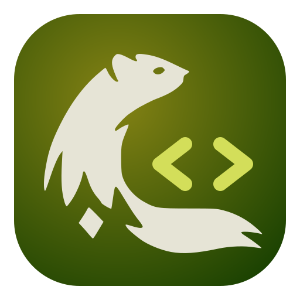

<p align="center">
  
</p>

<h1 align="center"><code>Code Personal</code></h1>

<p align="center">
  Upstream VS Code OSS stable, packaged for my own machines.<br>
  Bundled Copilot · Open VSX with signature checks · Remote SSH · telemetry off.
</p>

<p align="center">
  <code>code-personal</code> · Arch and Debian/Ubuntu · x64 ·
  identity: <a href="https://github.com/fyannk/design">fyannk/design</a>
</p>

---

This repository (`vscode-personnal`) tracks only the customization. Builds fetch
upstream into `.work/<version>/vscode` and write packages to `dist/`. Nothing is
copied from an existing VS Code install: no checkout, profile, credential or
extension.

## Install

Download a package from **Releases**, or use one from a local `dist/`.

```bash
# Arch Linux / CachyOS
sudo pacman -U ./code-personal-<version>-<revision>-x86_64.pkg.tar.zst

# Debian / Ubuntu (the ./ prefix lets apt resolve dependencies)
sudo apt install ./code-personal_<version>-<revision>_amd64.deb
```

Both packages install `/opt/code-personal`, `/usr/bin/code-personal`, desktop
entries and `code-personal` icons. They do not conflict with
`visual-studio-code-bin`, `code` or `codium`. The `.deb` uses upstream's own runtime
dependencies and is tested on Ubuntu 22.04 and 24.04.

**Update.** CI publishes packages; it does not install them. Install the new
package, then fully quit and reopen. Reload Window can keep an old icon or a
cached module.

**Roll back.** Keep previous packages and install one again with the same command.

**Uninstall.** `sudo pacman -R code-personal` or `sudo apt remove code-personal`.
Your profile and extensions stay.

**Taskbar badges** (counts and progress) need `libunity`. The `.deb` installs
`libunity9`. On Arch, install `libunity` from the AUR, then fully restart. Desktop
notifications work without it. The plain application archive installs no system
dependencies.

### Where data lives

| Data | Default path |
| --- | --- |
| Configuration and sessions | `~/.config/Code Personal` (or `$XDG_CONFIG_HOME/Code Personal`) |
| Extensions | `~/.code-personal/extensions` |
| Shared data | `~/.code-personal-shared` |
| Remote server data | `~/.code-personal-server` |
| URL scheme | `code-personal://` |

Upstream path and environment overrides still apply. Never point them at another
editor's storage.

## Remote SSH

Each release bundles **Code Personal Remote - SSH**, adapted from Open Remote - SSH.
On first connection it downloads the **Code Personal remote server** from the same
release. It never falls back to a VSCodium or Microsoft server.

- Command: **Code Personal Remote - SSH: Connect to Host…**
- Settings keep the standard `remote.SSH.*` names, including
  `remote.SSH.serverDownloadUrlTemplate` for a private mirror.
- The installer runs through `bash -l`. A host behind an HTTP(S) proxy should export
  `http_proxy` / `https_proxy` from its login profile.
- Remote authority is `code-personal-ssh`, separate from Open Remote - SSH's
  `ssh-remote`. After upgrading, reopen old `ssh-remote` windows with the Code
  Personal command.
- Linux x64 hosts only. Other architectures are not built yet.

**Air-gapped host.** Replace `HOST` with its SSH alias. The commit is the second
line of `code-personal --version`.

```bash
commit=$(code-personal --version | sed -n '2p')
scp code-personal-server-<version>-linux-x64.tar.gz HOST:/tmp/code-personal-server.tar.gz
ssh HOST "mkdir -p ~/.code-personal-server/bin/$commit && tar -xzf /tmp/code-personal-server.tar.gz --strip-components=1 -C ~/.code-personal-server/bin/$commit && rm /tmp/code-personal-server.tar.gz"
```

**"Signature verification was not executed".** The server could not load
`@vscode/vsce-sign`. Check `data/logs/*/remoteagent.log` for
`Could not load vsce-sign module`, install the current server archive, and restart
the remote server before reconnecting: a running server caches the failed import.
Keep `extensions.verifySignature` enabled.

## Build locally

Needs Docker for your normal user, about 25–35 GB of disk per build tree, and a lot
of memory (CI adds 8 GB of swap on its runner).

```bash
git clone git@github.com:fyannk/vscode-personnal.git
cd vscode-personnal
./scripts/build-container.sh                      # tag and commit from upstream.json
./scripts/build-container.sh --tag 1.136.1 --commit a44adf7f53e00964ab890f9f8758a334f1fc15bc
```

- The Arch container builds as an unprivileged user.
- Native modules use upstream's pinned glibc 2.28 sysroots, so the rolling Arch host
  does not leak a newer ABI into the desktop or server builds.
- Node comes from upstream's `.nvmrc` and is checked against its official SHA-256.
- `./scripts/build.sh` also runs natively with the dependencies listed in
  `Dockerfile`. Close Code Personal first: the smoke test launches it.
- `.work/<version>` is a disposable cache. Rebuilding reuses it and reapplies the
  overlay; delete it when done.

## Releases

**Build Code Personal releases** runs every six hours (minute 17), on relevant pushes
to `main`, and on demand: **Actions → Build Code Personal releases → Run workflow**.
Choose `latest` or a stable tag; clear **publish** for a test build.

1. Find the latest stable `microsoft/vscode` release and its exact commit.
2. Skip a version and revision already published; retry an unfinished draft.
3. Build in Arch Linux.
4. Verify, package, and install the `.deb` on Ubuntu 24.04 (see below).
5. Publish to this repository's **Releases** only if every check passed.

Tags are `personal-v<VS_CODE_VERSION>-r<PACKAGE_REVISION>`. Changed the
customization but not the VS Code version? Bump `packageRevision` in `config.json`.
It becomes the Arch `pkgrel` and the Debian revision.

Each artifact includes `build-info.json` with the upstream and customization
commits. Builds are traceable, not byte-for-byte reproducible: Arch packages update
inside the pinned base image.

**Security.** The build job is read-only; only a separate publish job can write.
Checkout keeps no credentials and no token reaches the build container. Actions and
the base image are pinned. Dependabot updates Actions, Docker and verifier
dependencies; `checks.yml` merges them once checks pass, except major verifier
updates. No PAT or extra secret is needed.

**Retention.** Release artifacts are deleted after upload (or expire after one day),
failure logs after seven days. Release assets stay until deleted. Scheduled runs
are polling and GitHub may delay them. Private Actions minutes count against your
account.

## Verification

| | What | How |
| --- | --- | --- |
| ● | Upstream metadata kept; separate identity and storage; icons and editor watermark | CI, every build |
| ● | Bundled Copilot manifest, runtime and SDK present, `buildType: prod` | CI, every build |
| ● | Telemetry defaults to `off` everywhere it is registered | CI, every build |
| ● | Desktop launches under Xvfb; a real Open VSX extension installs with signatures on; an altered VSIX fails | CI, every build |
| ● | Every native add-on stays within glibc 2.28 / GLIBCXX 3.4.25 | CI, every build |
| ● | The remote server's Node runtime can import the signature verifier | CI, every build |
| ● | `.deb` installs on Ubuntu 24.04: launcher, version, SQLite state, terminal PTY | CI, every build |
| ○ | Sign-in, entitled Copilot responses, ghost text, agents, Next Edit Suggestions | Manual, after major updates |
| ○ | Plasma Wayland pinning (CI runs headless X11) | Manual |

`●` checked automatically · `○` not checked automatically.

Only the container smoke test uses `--no-sandbox`, because nested sandboxing is not
available there. The flag is never written to the app, launcher, desktop entries or
settings.

## Maintain

| Path | Role |
| --- | --- |
| `overlay/product-overrides.json` | Identity, Open VSX endpoints, proposed-API allow-list |
| `overlay/customize.mjs` | Applies overrides, Copilot `prod` build, telemetry default, icons and watermark |
| `overlay/moduleignore.mjs` | Keeps the Copilot SDK that upstream's `.moduleignore` strips |
| `overlay/assets/` | App icon (`code-personal.svg`) and ermine editor watermark (`letterpress-*.svg`) |
| `overlay/remote-ssh/` | Vendored Code Personal Remote - SSH (MIT, from Open Remote - SSH 0.3.1) |
| `overlay/verifier/` | Pinned `node-ovsx-sign`, adapter and bundled Open VSX key |
| `overlay/arch/`, `overlay/debian/`, `overlay/deb-package.mjs` | Arch and Debian packaging |
| `overlay/verify.mjs` and other checks | Fail the build when an assumption breaks |
| `scripts/` | Preparation, build environment, release planning, collection |
| `tests/` | `npm test`, Node 22 or newer |
| `BUILD_HISTORY.md` | Historical notes; old paths are historical |

Details worth knowing before changing them:

- **Proposed APIs.** `code-personal.code-personal-remote-ssh` gets `resolvers` and
  `contribViewsRemote`; `openai.chatgpt` gets `chatSessionsProvider` and
  `languageModelProxy` so Codex works without a launch flag. Review a manifest
  before adding another proposal.
- **Copilot `buildType`.** Upstream sets `prod` only in its own CI. A source build
  keeps `dev` and tries to load `source-map-support` and `dotenv`, which are not
  shipped.
- **Telemetry.** VS Code OSS has no Microsoft endpoint, but bundled Copilot reports
  usage to GitHub unless `telemetry.telemetryLevel` is `off`. The default is patched
  to `off`; users can opt in. The build fails if upstream moves the setting.
- **`.moduleignore`.** Since 1.139 upstream strips `@github/copilot/**`, which also
  removed the SDK the built-in Copilot extension needs
  (`prepareBuiltInCopilotRipgrepShim` failed). The targeted rules are restored.
- **Signature verifier.** Bundled in desktop and server. `node-ovsx-sign` normally
  fetches Open VSX's key on every install with plain `node-fetch`, which ignores
  proxy settings. The adapter tries the bundled key first and asks the registry
  only if it rejects a signature. A rotated key works where the registry is
  reachable, otherwise it needs a rebuild. Update
  `overlay/verifier/package-lock.json` deliberately.
- **Debian dependencies** come from upstream's `build/linux/debian/dep-lists.ts`,
  plus `libsecret`, Kerberos and `libunity9`. No maintainer scripts; dpkg triggers
  refresh the desktop and icon databases.
- **Remote SSH.** Keep upstream attribution and licenses when updating it.
- **Identity.** Colors and marks follow [fyannk/design](https://github.com/fyannk/design).
  Edit the SVGs in `overlay/assets/`; the build renders the desktop PNG.

When upstream changes Copilot, product fields, Electron identity or signatures, a
check fails. Inspect the run and update the smallest relevant helper. Nothing is
patched or bypassed automatically.

## Notes

Copilot is enabled through the normal Chat setup and sign-in. Open VSX has a
different catalog from Microsoft's Marketplace. OSS Remote Tunnels lacks commercial
configuration; server and tunnel distributions are not built separately. No VSCodium patch
set or commercial product configuration is used.

References: [workflow triggers](https://docs.github.com/en/actions/reference/workflows-and-actions/events-that-trigger-workflows) ·
[upstream build guide](https://github.com/microsoft/vscode/wiki/How-to-Contribute) ·
[Open VSX in VS Code](https://github.com/eclipse-openvsx/openvsx/wiki/Using-Open-VSX-in-VS-Code)

For personal use. Upstream and dependency notices are kept; the verifier includes
EPL-2.0 code.
